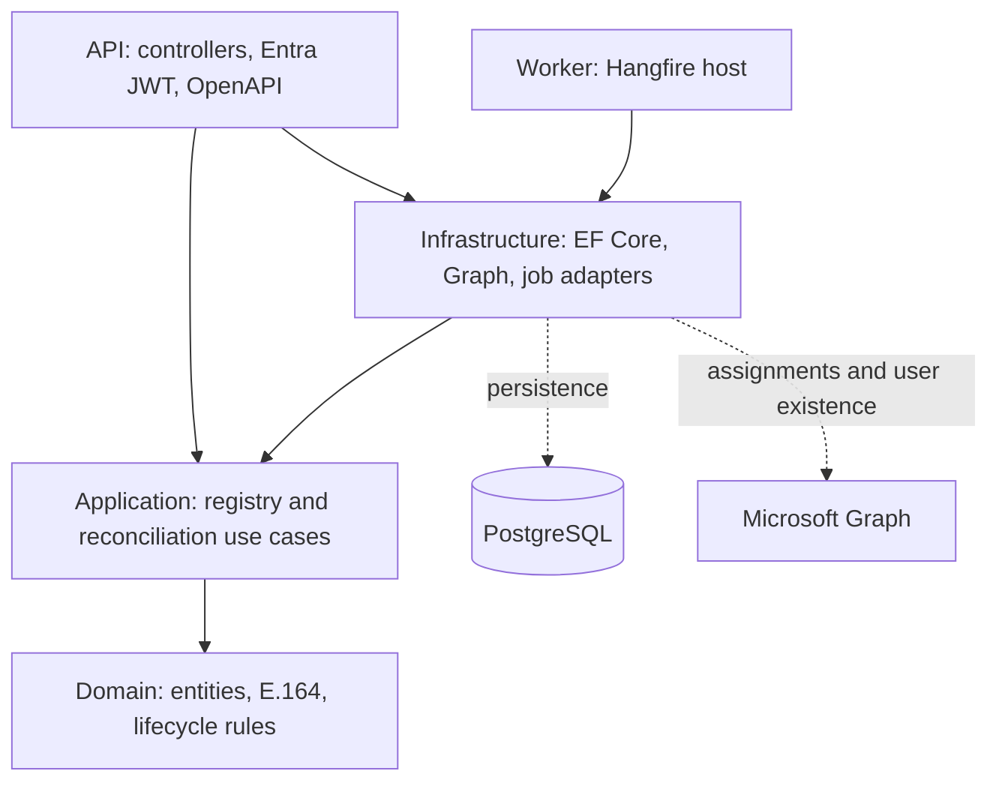
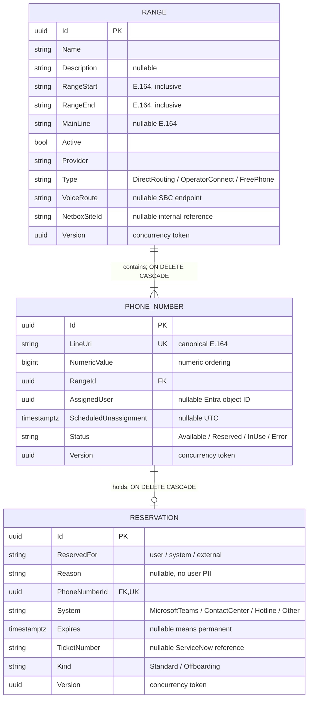

# Phone number registry architecture

## Project dependencies

Arrows mean compile-time dependencies. Domain has no dependencies. Application depends only on Domain. Infrastructure implements Application ports. API and Worker are composition roots; they register concrete adapters, while controllers and jobs delegate business decisions to Application.



The existing API project name is retained to avoid unnecessary solution and namespace churn. No generic repository or mediator library is introduced. The task-specific IRegistryStore port expresses the operations required by the use cases; EF Core supplies change tracking and transactional persistence. ITeamsDirectory isolates the external identity and telephony APIs. TimeProvider makes expiry deterministic and testable.

## Entity relationship schema



The relationship is zero-or-one current reservation per phone number, enforced by a unique index. This is an explicit initial assumption: historical reservations are not retained. Expired/deleted reservations are removed. If reservation history is required, introduce a separate history/audit model or an active-record filter before relaxing this constraint.

Creating a range creates every number between its inclusive endpoints in one transaction. Deleting a range cascades through numbers to reservations in the database, without recursive application loops or loading the children. Deleting a reservation does not delete its phone number. Foreign keys alone do not imply cascading; both relationships explicitly configure it.

## Number lifecycle

```mermaid
stateDiagram-v2
    [*] --> Available: range created
    Available --> Reserved: create reservation
    Reserved --> Available: reservation expires or is deleted
    Available --> InUse: authoritative Teams assignment
    Reserved --> InUse: Teams assignment consumes reservation
    InUse --> Reserved: confirmed missing user; 30-day offboarding hold
    Reserved --> InUse: user returns / assignment confirmed
    Reserved --> Available: offboarding deadline and user still missing
    Available --> Error: explicit write
    Error --> Available: explicit correction
```

Offboarding holds retain AssignedUser until release. They are distinguished from standard reservations by Kind and cannot be manually edited/deleted through reservation endpoints. ScheduledUnassignment is job-managed. A returning user keeps its assignment and cancels quarantine. The 30-day deadline is persisted; cleanup executes at the next configured polling interval, not at an exact second. There are two recurring jobs, not an extra Hangfire delayed job per number.

Error is an explicit operational state; transient Graph failures fail/retry the job and never mark an entire range as Error or Available.

## Consistency and concurrency

- Every mutation runs in a serializable EF transaction. Range creation and all child inserts commit or roll back together.
- Reservation insertion and the phone's status change commit together. A unique PhoneNumberId index and optimistic Version tokens prevent double reservation.
- Competing PostgreSQL transactions return HTTP 409 for uniqueness, serialization, foreign-key, or concurrency conflicts. Callers reload before retrying. GET availability never claims a number.
- PATCH detects intervening modifications between reading its merge base and committing. PUT is full replacement of editable values. Structural identifiers remain immutable.
- LineUri is globally unique. NumericValue supports numeric ordering; availability queries are bounded and indexed by RangeId, Status, NumericValue.
- Range creation is capped at 10,000 records, list endpoints at 1,000 records, availability requests at 1,000 numbers, and each cleanup invocation at 1,000 reservations.
- Range boundaries and number/range membership are immutable in this initial implementation. Metadata remains editable. Boundary migration needs a separate business decision.

## API and authorization

| Resource | Read | Create | PUT/PATCH | Delete |
|---|---|---|---|---|
| `/v1/ranges` | read/write/admin | admin | admin | admin |
| `/v1/phonenumbers` | read/write/admin | via range | write/admin | via range |
| `/v1/reservations` | read/write/admin | write/admin | write/admin | admin |

Entity routes use `/{id}` for GET, PUT, PATCH and DELETE. Collection GETs support the filters from the source specification and `offset`/`limit`. Phone lists additionally accept `rangeId`. `GET /v1/phonenumbers/getnextavailable?rangeId=...&amount=...` returns up to the requested number, ascending numerically. Fewer results are returned when insufficient numbers are available.

JSON enums use names, not integer values. PATCH accepts known camelCase input fields, changes only fields present in the JSON, and allows explicit null for nullable values. Unknown fields and invalid values fail. Null required fields fail validation. Immutable values may be supplied unchanged.

OpenAPI 3.1 is served at `/openapi/v1.json`, with bearer security definitions and policy/role descriptions. It is publicly readable; all business endpoints require authenticated Entra tokens and applicable app roles. In Development, Swagger UI at `/swagger` renders this same OpenAPI document with grouped, colored, expandable operations and an Authorize button. It adds no second schema generator and does not bypass endpoint authentication. The UI is not enabled in Production. No Hangfire dashboard is exposed.

## Teams integration

The adapter uses Microsoft Graph v1.0 telephone-number assignments rather than assuming user.businessPhones is authoritative Teams telephony data. It reads all pages (including skip-based pagination), processes userAssigned targets, and persists only canonical numbers and Entra object IDs. Unknown numbers outside managed ranges are ignored.

Application permissions require tenant-admin consent: TeamsTelephoneNumber.Read.All for assignment queries and User.Read.All for directory existence checks. Confirm these permissions and user/resource-account scope with LEGO before enabling the worker. Managed identity is preferred; DefaultAzureCredential also supports environment credentials for local testing.

Only an authoritative GET users/{objectId} 404 counts as missing. 401, 403, throttling, timeouts, invalid payloads, and other failures propagate and are retried by Hangfire. A stale Teams assignment for an already-deleted user must not reset the offboarding timer. Cleanup rechecks existence before releasing an expired offboarding hold.

This adapter does not assign/unassign telephone numbers in Teams. The current interpretation is a repository synchronized from Teams, with local quarantine and release. Confirm if remote mutation is required before adding write permissions.

## Decisions still requiring product confirmation

1. Correct completion date: the source says 15 October 2026 to 1 January 2026.
2. Reservation deletion: detailed page permits write/admin, overview implies admin. Implementation chooses admin.
3. Does next-available only query, or must a bulk operation atomically reserve X numbers? Current GET is read-only; reserve through POST, retrying conflicts.
4. Are arbitrary range-boundary edits required? Current boundaries are immutable; max range size is 10,000.
5. May admin delete a range containing live assignments? Current implementation follows the requested unconditional database cascade; it does not unassign Teams numbers.
6. Does offboarding require local release, actual Teams unassignment, or both? Is cleanup polling within five minutes acceptable?
7. Are historical reservations, audit trails, multiple reservations, external/resource-account assignments, or migration from the existing repository required?
8. Confirm field optionality, MainLine inclusion rules, provider values, Netbox reference format, and whether Reason is permitted free text.
9. Confirm hosting, database and migration permissions, app registration, actual role names, Graph permissions, internal catalogue publishing process, monitoring, and acceptance criteria.

Free-text Reason must not contain names/emails; technical validation cannot reliably detect all PII. Object IDs and telephone numbers can themselves be personal data in context, so the requirement should be expressed as data minimization rather than an absolute absence of personal data.

## Verification boundaries

The local tests use SQLite relational constraints plus deterministic clocks and simulated Graph responses. SQLite timestamp conversions are test-only. These tests cover real cascades/unique constraints, reservation conflicts, UTC expiry, offboarding idempotency, returning users, outage safety, PATCH conflicts, HTTP authorization policy behavior, and OpenAPI version/metadata. Test authentication exists only in the test project.

PostgreSQL migrations and serializable transactions must also be verified against an isolated PostgreSQL database. Live Entra JWT issuance, Graph permissions and Teams semantics, and Hangfire storage startup require an integration environment; passing local tests does not certify those external services.

Sources: [Npgsql EF Core 10](https://www.npgsql.org/efcore/release-notes/10.0.html), [Graph number assignments](https://learn.microsoft.com/en-us/graph/api/teamsadministration-telephonenumbermanagementroot-list-numberassignments?view=graph-rest-1.0), [ASP.NET OpenAPI customization](https://learn.microsoft.com/en-us/aspnet/core/fundamentals/openapi/customize-openapi?view=aspnetcore-10.0).

## Why migrations live in Infrastructure

EF Core migrations describe changes to a particular database schema. They depend on RegistryDbContext, the EF mappings, and the PostgreSQL provider, so they are infrastructure concerns. Domain contains business rules and has no EF dependency. Application orchestrates use cases through IRegistryStore and has no database dependency.

At runtime: Controller -> RegistryService (Application) -> IRegistryStore -> EfRegistryStore (Infrastructure) -> RegistryDbContext -> PostgreSQL. The service also invokes methods on Domain entities to enforce invariants. ASP.NET dependency injection wires the interface to its implementation; Application never needs to reference Infrastructure.

A separate Persistence project is a valid refinement if database adapters grow, several providers are supported, or a team needs a distinct ownership boundary. It would contain the context, mappings, store, and migrations together, with Infrastructure retaining Graph and job adapters. Alternatively, a dedicated Migrations project can reference the context's project, but requires configuring the migrations assembly and deployment tooling. Neither split is necessary for the current size. A separate migration executable/deployment step can be used without changing Domain or Application.
## Source layout and Code First

Each domain entity is in its own file under Domain/Entities. Domain exceptions, enums, and E.164 validation likewise have separate files. Application contracts and interfaces are one type per file. Each EF entity mapping lives in its own Infrastructure/Configurations class, discovered by RegistryDbContext.ApplyConfigurationsFromAssembly. The design-time context factory and Hangfire job classes are also separate files. Namespaces and type identities are unchanged by this organization.

Entity and configuration changes are the source for Code First schema evolution. Generating a migration compares the configured model with the prior snapshot and updates that snapshot; applying the migration updates the database and its migration history. See the README Code First workflow. File moves alone do not require schema changes or an empty migration.
