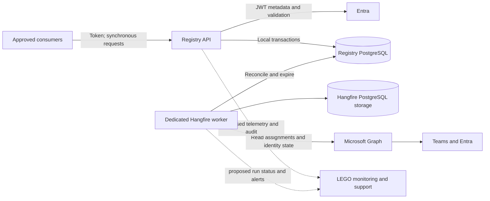

# Production architecture review: Phone Number Repository replacement

20 October 2026. Reviewed baseline: `6753a21780a799e0fac93b1b1fc946a68ef6240f` on dev and its current working copy. This report changes documentation only. The user's existing edit to RangesController.cs is excluded from changes and commits.

**Assessment: retain the API, PostgreSQL and dedicated Hangfire worker. Do not approve production number allocation/release until authority, reconciliation and real-provider verification are resolved. The supplied requirements do not justify RabbitMQ.**

## Evidence and confidence

Requirement evidence is the original statement of work and four screenshots supplied in this conversation: S1 = statement of work; S2 = overview diagram; S3 = Range API; S4 = PhoneNumber API; S5 = Reservation API. These are not assumed to constitute a final approved contract. The existing architecture.md records implementation choices, not independent product approval.

Entities, services, EF mappings/migration, Graph adapter, controllers/authentication, Hangfire host/jobs and tests were inspected. The existing tests were rerun: **24 passed, 0 failed, 0 skipped**. They use SQLite, simulated Graph and substituted authentication. They do not prove PostgreSQL migration/isolation behavior, real Entra tokens/permissions or Hangfire PostgreSQL execution. No live tenant, database, legacy export, traffic measurements or platform runbooks were available.

Labels: **Explicit** means stated in S1-S5; **Assumption** means selected during scaffolding; **Confirmed gap** means visible in code/artifacts, not necessarily a demonstrated production incident; **Proposal** needs approval; **Unverified** needs external evidence. Missing repository deployment artifacts do not imply LEGO lacks an external platform solution.

## Requirements traceability

| Requirement | Current implementation | Classification / action |
|---|---|---|
| .NET 10, PostgreSQL, EF; database supplied by product team (S1) | .NET 10, Npgsql, initial migration | Explicit; real database execution unverified |
| All listed entity attributes, E.164 numbers (S1-S5) | Fields and canonical syntax guards present | Implemented foundation; nullability, carrier ownership and extension normalization unverified |
| Synchronous CRUD on all entities (S1) | Numbers created/deleted through ranges | Ambiguous: detailed S4 omits phone POST/DELETE; clarify rather than invent endpoints |
| Next X available numbers from a range (S1) | Read-only GET, rangeId/amount; up to X results | Atomic claiming, partial results and ordering are not agreed |
| read/write/admin authorization (S1) | Global policies; range changes admin-only | Detailed S3 supports range policy; reservation DELETE uses admin but S5 permits write/admin. Resolve conflict |
| OpenAPI 3.1 with role names (S1) | Document, bearer scheme, descriptions, development Swagger | Locally tested; catalogue path/name and client compatibility unverified |
| API catalogue and Microsoft Identity registration (S1) | JWT configuration only | Actual registration, app roles, audience and onboarding unverified |
| Teams assignments; retain ObjectId instead of user profile PII (S1) | Graph assignments and user existence lookups | Endpoint choice/target categories and permissions need tenant validation |
| Two scheduled Hangfire jobs (S1-S2) | Dedicated worker, PostgreSQL job storage | Explicit; actual storage/startup/replay unverified |
| Missing user creates hold and 30-day scheduled unassignment (S1) | Persistent deadline; five-minute polling; local release | Local-only meaning and polling tolerance are assumptions; no remote unassignment adapter |
| Range creation generates numbers; deletion cascades reservations (S2-S3) | Transactional insert and FK cascade | Explicit; SQLite-tested, PostgreSQL behavior unverified |
| PATCH provided non-null values only (S3-S5) | Explicit null clears nullable values | Implementation departure requiring approval |
| Full entity updates (S3-S5) | Boundaries, number/range identity, reservation target immutable; scheduling job-managed | Additional restrictions need approval |
| Delivery dates (S1) | Start 15 October 2026, completion 1 January 2026 | Contradiction: obtain corrected completion date |

Other assumptions: one current reservation per number, no retained reservation history, 10,000-number range cap, 1,000-item query/cleanup caps, literal role names, 15-minute sync, no per-number delayed job, PUT interpreting the source's UPDATE verb, and /{id} update routes.

## System boundary and authority

One bounded context owns managed inventory and reservation rules. API and worker are separate processes of the same service. Domain/Application remain independent of persistence and external SDKs. Infrastructure implements their ports. A separate Persistence project is optional organization, not a production safety measure.



Dotted operational paths are proposals. Hangfire can share PostgreSQL using separate tables/schema and appropriate permissions; a separate database depends on platform requirements. JWT validation normally uses cached signing metadata, not a directory lookup on every request.

| Data or decision | Proposed authority | Confirmation needed |
|---|---|---|
| Managed ranges/provider/site/Active | Product-controlled registry input backed by telephony inventory | Who approves range ownership? Is Netbox a reference or source? |
| Current reservations and expiry | Registry transactions | One active hold? Historical records? |
| Actual Teams assignment | Approved telephony endpoint | businessPhones vs LineURI vs numberAssignment; required providers/targets |
| Offboarding | Entra observations under product policy | Deleted vs disabled vs soft-deleted; resource accounts; restoration |
| Permission to reuse | Registry combining holds with sufficiently fresh assignment evidence | Maximum staleness; outage behavior; sole-writer arrangements |
| Actor/roles | Approved Entra registration | Application vs delegated callers; global vs scoped access |

Current phone PUT/PATCH and sync can both change AssignedUser. Transactions do not resolve competing business authorities. Restrict these fields to reconciliation, or define an explicit audited override with precedence/expiry. Do not assume merely existing in Entra means a user still owns a particular telephone number.

## Invariants and complete lifecycle proposal

1. Canonical E.164 is globally unique; each number belongs to one managed range and lies within its inclusive endpoints. Overlaps are rejected atomically.
2. At most one current reservation under the present model; history, if required, needs distinct storage/active uniqueness semantics.
3. Available means no assignment, no current reservation/offboarding hold, and approved freshness/release evidence. An inactive range cannot issue reservations; it still needs reconciliation.
4. Claim, reservation insert and number state change commit together. GET availability is not a claim.
5. Reprocessing the same offboarding episode preserves the first deadline. A new episode after a confirmed return has a new hold identity.
6. Timeout, forbidden, throttled and malformed external responses mean Unknown, not Missing. Unknown does not authorize release.
7. Persist UTC deadlines; null means permanent. Define timestamp tolerance and whether expired-but-not-cleaned reservations remain unavailable. Current code keeps them unavailable until cleanup.
8. Release and reassignment must match the expected number, owner, hold and version. Old observations cannot authorize changing a new owner's assignment.
9. Deletion follows the explicitly agreed cascade policy. Deleting local records never proves remote unassignment.
10. GET is read-only; arbitrary status/owner/hold combinations are forbidden. Unique keys/FKs guard competing processes; add practical database checks for agreed invariants.

```mermaid
stateDiagram-v2
    [*] --> Available: approved range created
    Available --> Reserved: atomic reservation
    Reserved --> Available: standard expiry/deletion; checks pass
    Available --> InUse: authoritative assignment
    Reserved --> InUse: approved reservation consumption
    InUse --> OffboardingHold: confirmed offboarding; first deadline
    OffboardingHold --> InUse: return and assignment confirmed
    OffboardingHold --> ReleasePending: deadline reached
    InUse --> ReleasePending: assignment removed or transferred
    ReleasePending --> Available: approved release evidence
    ReleasePending --> OffboardingHold: unknown or conflicting evidence
    Available --> Error: operational/manual transition
    Error --> Available: correction and availability checks
```



OffboardingHold/ReleasePending are conceptual stages, not existing public enum members. Today the offboarding state uses Reserved, Kind=Offboarding, AssignedUser and ScheduledUnassignment. If needed, add a separate hold/reconciliation substate or durable operation after approval; preserve the four requested public statuses unless changed deliberately.

Reassignment A->B invalidates A's offboarding evidence. If A moves to another number, reconcile A's old number too. Record observation age/generation and compare expected state; reread destructive/conflicting candidates. A paginated Graph scan is not proven to be a single atomic snapshot.

Range metadata can change; boundaries currently cannot. If boundary changes are required, calculate added/removed records and handle assigned/reserved removals under explicit policy. Do not delete/recreate to emulate an update and change stable IDs. Agree MainLine inclusion and national-range rules.

S3 explicitly requests cascade deletion, including reservations. Blocking live ranges or using soft deletion is a proposed amendment, not an automatic correction. Agree authorization, audit and recovery; test lock/latency impact and downstream references. Deleting a reservation never deletes its phone.

## Prioritized gaps and code evidence

P1 means resolve before production use of the affected path; P2 means before agreed scale/go-live; P3 is conditional. Decisions are separated from confirmed code limitations.

| ID | Priority / evidence | Finding and consequence | Required action |
|---|---|---|---|
| G01 | P1, confirmed + authority decision | Cleanup checks user existence then releases locally, without verifying/removing Teams assignment. Local Available can coexist with an occupied external number. | Define local vs remote unassignment and release evidence; do not enable production reuse until resolved |
| G02 | P1, confirmed | Sync applies positive assignments and handles missing users, but omits assignment removal when a user still exists. A moved/removed number can remain InUse indefinitely. | Reconcile managed inventory against assignments, including removals and transfers |
| G03 | P1, confirmed exposure | An external assignment list predates writes; no observation-generation/freshness guard exists. Old work can overwrite a later manual update or consume a newly created reservation. | Approve authority/consumption policy; compare expected state and observation freshness |
| G04 | P1 for documented setup, confirmed | Worker uses HangfireConnection ?? RegistryConnection; appsettings supplies an empty Hangfire string. Configuring only Registry does not activate the documented fallback. | Nonblank fallback/startup validation and absent/blank/explicit configuration test |
| G05 | P1 verification gap | SQLite EnsureCreated and fake auth do not test PostgreSQL migration/isolation or Hangfire storage. | Real-provider tests with independent connections/processes and failure injection |
| G06 | P1 decision | GET then POST is not atomic allocation of X; response-loss retries lack an idempotency contract. | Agree query/claim and partial/all-or-nothing semantics; add synchronous transactional claim/replay identity if required |
| G07 | P1 decision | Reservation DELETE role contradicts S5; assignment fields have API and sync writers. | Approve endpoint/field role matrix and validate actual Entra tokens |
| G08 | P2, confirmed | First failed cleanup item aborts the run; retries can revisit the same oldest batch and starve independent work. | Isolate item failures, retain unsafe holds, continue safe work, alert on poison items/backlog |
| G09 | P2, confirmed | No request-level Retry-After/backoff; job retries restart prior work; repeated per-user lookups, including for unmanaged numbers. | Bounded retry/backoff, limited within-run lookup reuse, managed filtering, rate instrumentation |
| G10 | P2, confirmed limitation | Per-job concurrency attributes do not serialize sync against cleanup/API; a lost job lock is not exactly-once execution. | Database expected-state guards, idempotency, crash and overlapping-worker tests |
| G11 | P2, confirmed limitation | PATCH protects its server merge window, not an old client GET. PUT lacks a client version precondition; sequential stale writes can overwrite accepted changes. | Decide ETag/If-Match or explicit version contract, including deletes |
| G12 | P2, confirmed | Expired/deleted/consumed reservations disappear; no business audit/run records. 500 logging retains type/trace but little diagnostic context. | Approved audit/retention and structured operational evidence without sensitive payloads |
| G13 | P2, environment unverified | No CI/deployment/IaC, health/readiness, metrics or recovery runbooks in repository. | Establish what LEGO provides externally and assign/prove missing capabilities |
| G14 | P2 decision | Caps, one current hold, immutable boundaries, null-clearing PATCH and ignored non-user/unknown assignments lack product approval. | Sign off each interpretation; surface unknown/conflicting assignments |
| G15 | P3 conditional | Broker, additional microservices, separate persistence/migration executables. | Add only for an evidenced consumer, ownership, scale or operational requirement |

Independent code anchors, relative to repository root (line positions at reviewed baseline):

- G01/G08: `Backend/PhoneNumbersManagement/PhoneNumbersManagement.Application/ReconciliationService.cs:96` cleanup; `:115` EndAsync.
- G02/G03: same file `:10` external list, `:43` hold removal, `:46` assignment, `:51` missing-user loop.
- G04: `Backend/PhoneNumbersManagement/PhoneNumbersManagement.Worker/Program.cs:7` plus `appsettings.json`.
- G05: `Backend/PhoneNumbersManagement/PhoneNumbersManagement.Tests/TestDatabase.cs:29` and `ApiTests.cs:92`.
- G06/G11: `Backend/PhoneNumbersManagement/PhoneNumbersManagement.Application/RegistryService.cs:67`, `:99`, `:44`; update controllers supply expectedVersion only for PATCH's server merge.
- G07: `Backend/PhoneNumbersManagement/PhoneNumbersManagement/Controllers/ReservationsController.cs` DELETE policy and `RegistryService.cs:82` phone update.
- G09: `Backend/PhoneNumbersManagement/PhoneNumbersManagement.Infrastructure/GraphTeamsDirectory.cs` SendAsync; `ServiceRegistration.cs` HTTP client.
- G10: `Infrastructure/Jobs/MicrosoftTeamsIntegrationJob.cs` and `CleanupReservationsJob.cs`; G12: `PhoneNumbersManagement/ApiExceptionHandler.cs` and reservation removal paths.

Existing protections worth retaining: transactional status+reservation insertion, serializable local writes, unique number/reservation keys, optimistic tokens, persistent UTC deadlines, no interpretation of 401/403/429 as missing, bounded queries, and trusted-host pagination. These do not establish atomic consistency with Graph.

## Failure detection, containment and recovery

| Scenario | Detection | Containment and recovery proposal |
|---|---|---|
| Competing claims | Unique/version/serialization outcome; conflict metrics | One committed claim; agreed conflict/replay results for losers; recalculate in a fresh transaction |
| PostgreSQL serialization/deadlock | SQLSTATE 40001/40P01 and operation ID | Roll back whole transaction. Bounded jittered retry only for safe whole operations; current code maps conflict but does not retry internally. Do not retry only SaveChanges |
| Commit succeeded, HTTP response lost | Client timeout with unknown outcome | Caller/payload-scoped idempotency key returns original result; conflicting reuse rejected. Blind POST retry cannot prove prior outcome |
| Database outage/failover | Readiness, connection/command errors | No false success or partial rows; bounded requests and temporary-failure response; resume jobs after recovery; test provider behavior |
| Worker death after partial sync | Unfinished run/last-success age; retried job | Per-item commits can remain. Next run must converge; retain completeness and item outcomes, never claim whole-scan atomicity |
| Graph 429/503/timeout | Status, Retry-After, request ID, latency | Respect header, otherwise bounded exponential backoff+jitter; preserve unsafe holds; alert on freshness breach |
| Graph 401/403/wrong tenant | Permission/identity diagnostics | Fail closed, alert identity owner, no absent-user inference; restore config/consent then reconcile |
| User 404/disabled/restored | Validated directory response and observed time | Approve offboarding signal; current disabled user is still Exists. Recheck current assignment before release under chosen policy |
| Partial/stale/mutating pages | Completion/duration/duplicate/conflicting-owner evidence | Failed scan cannot justify release; verify destructive candidates with fresh evidence and defer contradictions |
| Assignment changes around release | Expected assignment/version mismatch; external verification | Retain hold/reconcile new owner. If remote mutation is required, persist intent, verify uncertain result, then finalize local state |
| Job overlap/lease loss | Run IDs and transition conflicts | Database invariants/conditional updates maintain correctness; replay harmless. Different job types can overlap |
| Poison item/cleanup backlog | Per-item failures, oldest expiry, backlog trend | Keep failed hold, isolate/alert it and continue independent safe expiry; pause affected releases for systemic failures |
| Large range create/delete | Latency, lock waits, cancellation/rollback metrics | Enforce approved bounds, atomic rollback, reviewed indexing/bulk strategy; preserve synchronous contract |
| Stale client update | Client precondition vs current version | Reject and reload/merge; separate this from backend retry conflicts |
| Signing metadata/credential outage | Auth diagnostics, identity expiry monitoring | Never bypass validation; restore identity path and verify recovery |
| Restored DB/job state is stale | Backup point, restored pending work, external diff | Start isolated with release paused, reconcile external reality, then resume; restored jobs may replay |

PostgreSQL serializable transactions can abort and need whole-transaction retry handling [PostgreSQL isolation guidance](https://www.postgresql.org/docs/current/transaction-iso.html). Hangfire's concurrency-filter guidance explicitly calls for transactions/CAS and idempotency for safety [Hangfire concurrency guidance](https://docs.hangfire.io/en/latest/background-processing/throttling.html). Graph requires respecting throttling delays [Graph throttling guidance](https://learn.microsoft.com/en-us/graph/throttling). None supplies exactly-once external effects.

## Decision records and architecture sufficiency

**ADR-01: retain the deployable shape. Proposed.** Local mutations commit in Registry PostgreSQL; Hangfire persists/schedules recurring work in a continuously hosted worker. Teams consistency is eventual reconciliation. Current requirements need no broker. Define who keeps the worker running and responds to failed jobs.

**ADR-02: one authority per field. Pending product approval.** Proposed: Registry owns reservations/inventory; Teams owns actual assignments; Entra supplies identity observations. Restrict or explicitly audit manual overrides. Persist enough observation/run provenance to explain transitions. This fits inside the current service.

**ADR-03: safe release and durable intent. Pending product approval.** Decide local-only vs remote unassignment. Remote mutation needs a persisted release operation with an identity and recoverable steps; Hangfire can drive it. A database commit followed by enqueue can fail between steps, so derive/enqueue work from durable intent. Adding a broker would not close this gap automatically.

```mermaid
sequenceDiagram
    participant W as Worker
    participant DB as Registry database
    participant T as Approved Teams API
    W->>DB: Load due hold and expected owner/version
    W->>T: Obtain current assignment and identity evidence
    alt Unknown, stale or reassigned
        W->>DB: Retain hold; record reason and retry status
    else Release allowed by approved policy
        opt Remote unassignment is in scope
            W->>DB: Persist release intent and operation identity
            W->>T: Request unassignment
            W->>T: Verify outcome after response or timeout
        end
        W->>DB: Conditional transaction against expected hold/owner; finalize availability and audit
    end
```

This proposed flow does not promise atomicity across Teams/PostgreSQL. External changes after verification still need an approved sole-writer/freshness policy and reconciliation. Durable intent protects crash recovery; verification and idempotency resolve uncertain outcomes.

**ADR-04: broker conditional, deferred.** Reconsider for durable events required by independent consumers, independent backpressure/deployment, or a mandated LEGO integration platform. Identify consumers, ordering scope, retention, outage tolerance and ownership first. Choose an approved platform, not RabbitMQ by default.

If publication is required, commit an outbox entry with the business change, publish with confirmation, apply consumers idempotently, and provide poison-message/replay procedures. Expect at-least-once delivery with duplicates and eventual consumer consistency, not end-to-end exactly-once [RabbitMQ reliability guidance](https://www.rabbitmq.com/docs/reliability). Operational costs include broker HA, upgrades, TLS/credentials, queue limits, monitoring, schema compatibility, ordering and dead-letter support. No external event publication is specified today, so outbox/broker is optional.

**ADR-05: Code First and explicit deployment migrations. Retain.** Entities/mappings define the model; generation updates snapshot and migration, deployment applies reviewed schema changes. Separate DML and migration privileges. Use expand-before-contract for rolling compatibility. Additional persistence/migrator projects are optional.

**ADR-06: approve API semantics first. Pending.** Resolve role conflicts, null PATCH, immutable fields, X-result behavior and stale-client/replay contracts. Atomic allocation can remain synchronous and transactional; CQRS/MediatR and messaging are not prerequisites.

**ADR-07: preserve cascade requirement with risk ownership. Pending.** Keep specified physical cascades unless LEGO approves blocking/deactivation/history instead. Before enabling them, prove authorized/audited behavior and recovery. Active reservations that disappear cannot double as a retained audit trail.

## Authorization, privacy, deployment and support

Validate actual issuer/tenant, audience, signature, expiry and approved app roles through JWT middleware. Test every endpoint/action with real approved human/app tokens, read/write/admin/no role, expired/wrong-audience/wrong-tenant tokens. Existing fake authentication proves policy behavior, not cryptographic validation or app registration. Confirm whether roles are global or scoped to sites/ranges. OpenAPI descriptions do not create roles. Agree whether publicly readable OpenAPI on the internal service is acceptable and how the catalogue consumes it [Microsoft claim-validation guidance](https://learn.microsoft.com/en-us/entra/identity-platform/claims-validation).

Use separate runtime/migration privileges where practical: API registry DML, worker registry DML/Graph/Hangfire permissions, deployment identity DDL. Prefer a constrained production managed identity/certificate; explicitly establish intended tenant and identity rather than relying on a developer credential fallback. The selected Graph endpoint documents application TeamsTelephoneNumber.Read.All [Graph number-assignment documentation](https://learn.microsoft.com/en-us/graph/api/teamsadministration-telephonenumbermanagementroot-list-numberassignments?view=graph-rest-1.0); verify directory permissions with tenant owners. Do not add remote write consent until remote mutation is approved. Confirm Hangfire PostgreSQL provider/platform support and any private Pro package licensing separately.

ObjectId + phone links may identify people. Avoiding names/emails is minimization, not anonymity [European Commission guidance](https://commission.europa.eu/law/law-topic/data-protection/information-business-and-organisations/application-gdpr_en). Agree approved free text, encryption, support access, retention, deletion and backup handling. Reason can contain PII even when ReservedFor is restricted to user/system/external. Do not log tokens/raw Graph profiles. Audit actor identifiers also need appropriate retention/access controls.

Proposed telemetry: correlated API operation and reconciliation-run IDs; API latency/errors/conflicts; database connection pool/locks/aborts; complete-sync last-success age, duration and coverage; Graph throttles/errors; unknown/conflicting assignments; cleanup backlog and oldest deadline; Hangfire failures/queue delay; worker heartbeat; release decisions. Separate liveness/readiness. Graph outage need not make all API reads unhealthy, but stale evidence should block reuse under the agreed budget. Store restricted internal diagnostics while exposing generic external ProblemDetails. Current exception-type-only 500 logs provide limited incident evidence.

Deploy API and worker independently with agreed always-on hosting, shutdown deadlines and migrations before compatible code rollout. Add CI for build/tests, real PostgreSQL migration tests, package/secret checks and OpenAPI validation. Supply environment-owned secrets and connection/command timeout settings. No production migration is performed by this review. A migration rollout must have backup, compatibility and recovery evidence; reversing a migration is not automatically a safe data rollback.

Proposed ownership, to be assigned to named teams:

| Responsibility | Proposed owner |
|---|---|
| Lifecycle, range ownership, release/cascade approvals | Product and telephony owners |
| API/jobs/contracts, reconciliation incidents and runbooks | Application team |
| Tenant consent, app roles, identity lifecycle | Identity team |
| Hosting, database capacity/backups, monitoring platform | Platform/database teams |
| Schema deployment and restore validation | Application and database teams jointly |
| Manual overrides and incident escalation | Named primary service owner with telephony approval |

Backups: obtain evidence of automated backup/PITR, retention/encryption and restore drills; a provided database is not proof. PostgreSQL PITR uses base backup plus retained WAL/managed equivalents [PostgreSQL recovery documentation](https://www.postgresql.org/docs/17/continuous-archiving.html). Agree numeric RPO/RTO. After restore pause release, validate code/migration versions, reconcile restored inventory to Teams and resolve unknown commit outcomes. Coordinate Hangfire/registry restore points: restored jobs can replay. Never treat database restore as undoing Teams mutations.

## Existing-system migration and cutover

1. Obtain legacy schema, sanitized data/export, status/range counts, consumers/contracts, external IDs and current writer inventory.
2. Profile duplicates, overlaps, noncanonical LineURI/extensions, orphan reservations, missing ObjectIds, expiry/time zones and provider/site values. Produce explicit reject/disposition reports; do not silently merge conflicting identities.
3. Define deterministic ID/reference mapping, UTC and status conversion, permanent holds and existing offboarding deadlines. Preserve downstream references or agree a compatibility map. Import must not invent immediate release for missing users.
4. Rehearse import into isolated PostgreSQL created by real migrations. Compare counts, every invariant and per-number telephony reconciliation; preserve an exceptions ledger.
5. Run read-only/shadow reconciliation with no release side effects. Have telephony approve differences. Never permit two independently writable reservation inventories.
6. Approve write freeze or controlled single-writer switch, final delta import, consumer/catalogue/network/identity configuration and rollback checkpoint.
7. Validate claims, reads, expiry and controlled integration cases, then monitor during the agreed window. Keep legacy read-only while retention and rollback policy allow.
8. Rollback reconciles every post-cutover write and external action before restoring an old writer. DNS or old backup alone loses valid new reservations; restoring local data does not reverse Teams.

## Measurable acceptance criteria and test plan

All numeric load/operational examples below are **proposed acceptance targets**, not contracted SLOs. Establish real inventory, peak volume and approved headroom before signing targets. Use disposable, production-compatible PostgreSQL, real migrations, independent contexts/processes, and deterministic concurrency barriers. Approved tenant testing uses controlled telephony/user fixtures, never uncontrolled real staff accounts. Advance TimeProvider locally for 30-day behavior; separately verify live permissions/response semantics rather than waiting 30 days.

| ID | Test | Observable pass condition |
|---|---|---|
| AC01 | Fresh migration and representative prior-schema upgrade | Reviewed SQL applies; model unchanged afterward; existing data preserved; no EnsureCreated substitute |
| AC02 | 100 concurrent claims on one number, two API instances/connections, repeated 100 times | Exactly one committed current reservation and consistent phone state per run; agreed loser results; no partial rows |
| AC03 | Claim/expiry, delete/claim, assignment/cleanup races with controlled barriers | All approved invariants hold; no release of current/different owner, orphan rows or duplicate claim |
| AC04 | If approved, competing bulk X claims with insufficient inventory | Disjoint committed results; exact approved all-or-nothing/partial/ordering semantics. If GET only: zero mutations |
| AC05 | Overlapping ranges concurrently; minimum/maximum range; cancellation mid-create | Overlap rejected, inclusive count correct, rollback leaves no partial inventory; agreed latency bound |
| AC06 | PostgreSQL cascade under live holds/assignments and competing requests | Approved cascade/block contract and authorization met; no orphans; agreed audit/recovery evidence preserved |
| AC07 | Expiry before/at/after UTC boundary, permanent hold, restart and clock tolerance | No early release; null expiry retained; deadline persists; eligible cleanup within agreed lateness budget |
| AC08 | Deleted/disabled/restored user, return without assignment, A->B reassignment | Approved offboarding signal followed; retries preserve deadline; A's hold never releases B; existence alone does not override assignment rules |
| AC09 | Old external observation after new observation/manual override | Old work rejected/deferred/superseded according to approved precedence, with explanatory audit |
| AC10 | Graph 429+Retry-After, 503, 401/403, timeout, malformed/partial/mutating pages, repeated/untrusted links | No outage interpreted as missing; bounded delays/retries observed; no premature reuse; subsequent run converges |
| AC11 | First item fails in a >1,000-item expiry backlog | Failed item retained/alerted; independent cleanup progresses; no starvation; backlog drains within agreed budget |
| AC12 | Worker killed before/after commit or during uncertain external call; two workers | Work resumes safely, timer not reset, no duplicate external effects; uncertain outcomes verified |
| AC13 | Registry-only plus blank Hangfire, missing Hangfire, explicit separate storage, bad credentials | Documented fallback works; invalid settings fail clearly; correct schema used; no registry DDL privilege needed at runtime |
| AC14 | Real Entra token matrix across every action | Correct success/401/403 for approved roles/caller modes; wrong tenant/audience/expired/no-role rejected; no token leaks |
| AC15 | Approved tenant fixtures for every required provider/assignment category | Endpoint mapping agrees with Teams admin evidence; permissions minimal/approved; ignored/unknown cases reported |
| AC16 | Removed/moved assignments with existing users, unknown numbers and interrupted scan | Approved reconciliation outcomes, completeness/freshness observable, no silent drift; safe recovery |
| AC17 | Lost response after commit, replay same/conflicting key/payload; stale PUT/PATCH/DELETE | Approved replay/precondition behavior with no duplicate effect or stale overwrite |
| AC18 | Measured inventory/forecast peak, proposed 30-minute sustained run | Sign p95/p99 latency, error budget, sync/release window and Graph call budget before test; report headroom, pool/locks/aborts |
| AC19 | Isolated restore from actual backup including relevant job state | Measured RPO/RTO meet agreed numbers; workers paused, divergence identified, safe resumption demonstrated |
| AC20 | Migration/cutover and rollback rehearsal with post-switch writes | Counts/invariants reconcile; exactly one writer; new writes and external actions preserved/reconciled; consumer compatibility verified |
| AC21 | Stopped worker, stale sync, poison cleanup, revoked consent | Alerts reach named support within proposed five minutes; another engineer can diagnose/recover using runbooks/evidence |
| AC22 | Inspect tables, logs/errors/audit/backups | Only approved data retained; no unexpected names/emails/tokens; actor/outcome audit and retention meet agreement |

Current passing tests do not certify AC01-AC22. Prioritize tests of confirmed defects/exposures: worker fallback, removed assignments, unsafe release evidence, poison-item progress and PostgreSQL adverse interleavings. Existing role tests cover range creation, not every role/action. Test all approved transitions, not just methods matching implementation.

## Staged implementation plan and release gates

| Stage | Work | Exit evidence |
|---|---|---|
| 0: decisions and access | Correct dates; legacy data/consumers; authority, offboarding, allocation, field/role/cascade decisions; assign owners/volumes/SLO/RPO/RTO | Signed requirement matrix and access/fixture plan |
| 1: real integration baseline | After approval fix config fallback; disposable PostgreSQL/migration/worker CI; approved tenant identity probes | AC01/AC13 and initial AC14/AC15 pass, no production mutations |
| 2: local correctness | Approved allocation/replay/preconditions, lifecycle guards and audit | AC02-AC07/AC17 pass on PostgreSQL; API contract agreed |
| 3: reconciliation and recovery | Removed/transferred assignments, fresh evidence, stale-work guards, request retry, poison isolation, run records and release intent if needed | AC08-AC12/AC16; replay/partial-failure recovery demonstrated |
| 4: operation and deployment | Constrained identities, rollout/migration pipeline, telemetry/readiness, alerts/runbooks, restore | AC18/AC19/AC21/AC22; platform/identity/support sign-off |
| 5: replacement | Deterministic import, shadow comparison, one-writer switch, rollback rehearsal, catalogue onboarding | AC20 and end-to-end product/telephony acceptance before automatic release enabled |

No fixed calendar estimate until access/consent lead times and corrected delivery scope are known. Independent platform/product/identity preparation can progress concurrently, but destructive business behavior must follow signed lifecycle decisions. This review does not itself implement any proposed change.

## Product questions in priority order

1. Correct completion date and minimum accepted delivery?
2. Mirror/reservation repository only, or actual Teams assignment/unassignment? Who else can write assignments?
3. What starts the 30-day period: deletion, disablement, licence removal, offboarding event? What cancels it, and is five-minute cleanup tolerance acceptable?
4. What fresh evidence permits reuse; what happens during an extended directory/Teams outage?
5. Is next-X discovery or atomic claim? Exact X vs partial, contiguous vs merely ascending, reservation replay semantics?
6. Does a reservation target an actual user ObjectId or just a category? How should conflicting assignments consume/override reservations? Is history required?
7. Authority/override rules for AssignedUser and Status; global vs site/range roles; correct reservation DELETE policy?
8. May live ranges cascade-delete? Do downstream IDs/audit need retention? Is deactivation a contract change?
9. Required boundary changes/phone POST-DELETE/null PATCH/immutable field semantics?
10. Required Teams providers, national cloud, resource/shared-calling targets, non-Teams numbers and extensions?
11. Real inventory/max range/peak clients/change volume; API/sync/release latency and freshness budgets?
12. Who supplies PostgreSQL/version/permissions, hosting, Hangfire provider approval, Graph consent, fixtures, catalogue integration and CI?
13. Existing-data/consumer compatibility, write freeze, rollback requirements and incident/manual-override owners?
14. Privacy/audit/retention rules, availability objectives and numeric RPO/RTO?

## Recommendation and unverified dependencies

Keep the current system shape. Resolve authority/reuse semantics first, establish real-provider evidence, then fix the confirmed reconciliation/configuration/recovery gaps. Add messaging only for a concrete consumer/platform requirement. Production approval depends on lifecycle, security, concurrency, migration and restore evidence, not the number of projects or libraries.

Still unverified: tenant endpoint availability/consent/response categories; Teams propagation timing and live unassignment behavior; supplied PostgreSQL version/capacity/backups/permissions; Hangfire provider behavior; true workload and SLO; catalogue requirements; existing inventory/clients; organizational security/privacy/operating approval. This report distinguishes these dependencies from locally inspected code and 24 passing local tests.

## Authoritative references

[D1] [PostgreSQL serializable isolation and retry](https://www.postgresql.org/docs/current/transaction-iso.html).

[D2] [Hangfire concurrency safety limitations](https://docs.hangfire.io/en/latest/background-processing/throttling.html). Cited for filter limitations, not to recommend the private throttling package.

[D3] [Microsoft Graph throttling guidance](https://learn.microsoft.com/en-us/graph/throttling).

[D4] [RabbitMQ reliability and duplicate delivery](https://www.rabbitmq.com/docs/reliability).

[D5] [Microsoft identity platform claim validation](https://learn.microsoft.com/en-us/entra/identity-platform/claims-validation).

[D6] [Graph numberAssignments permissions and pagination](https://learn.microsoft.com/en-us/graph/api/teamsadministration-telephonenumbermanagementroot-list-numberassignments?view=graph-rest-1.0).

[D7] [European Commission: personal data and identification](https://commission.europa.eu/law/law-topic/data-protection/information-business-and-organisations/application-gdpr_en).

[D8] [PostgreSQL continuous archiving and PITR](https://www.postgresql.org/docs/17/continuous-archiving.html). Match operational procedures to the supplied database version/service.
